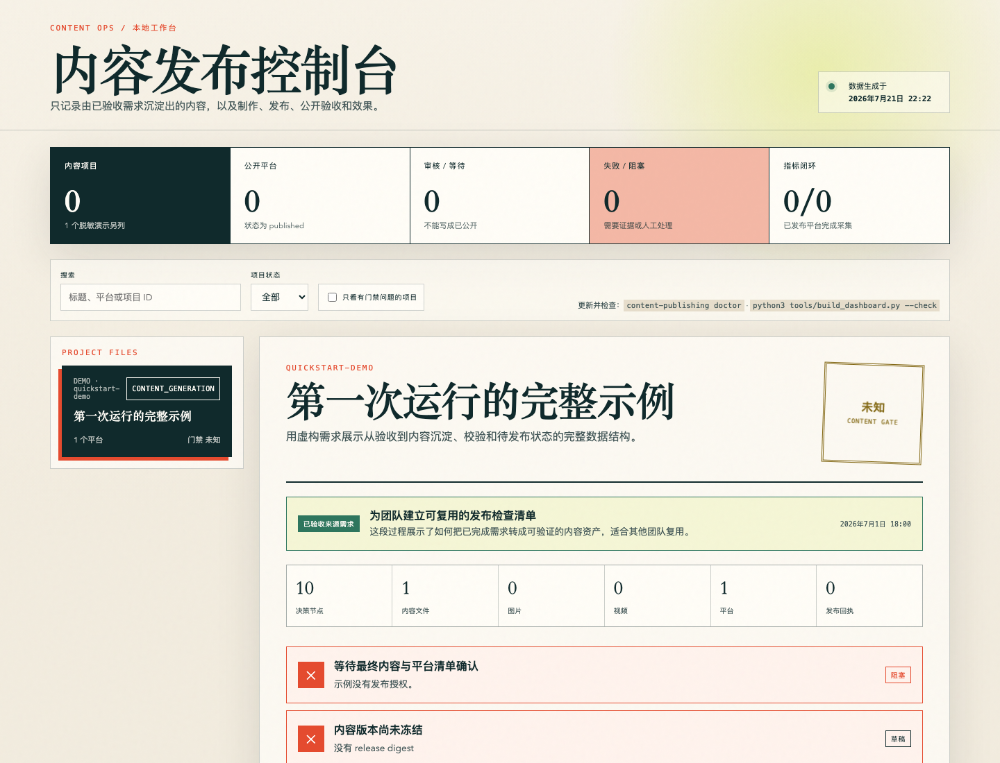

# Content Publishing SOP

一套跨机器、跨 IDE 的内容生产、个人表达校准、平台风格适配、完整性校验和发布治理工具。它只在来源需求已经完成并验收、用户随后明确要求沉淀经验时启动。

当前版本：`0.3.0`。



## 先说清楚：现在能做什么

已经可执行：

- 从模板事务化创建内容项目并登记到看板；
- 校验九阶段讨论、母稿、图片、视频和完整 canonical prompt；
- 只读检测文章来源项目是否已有可复用的公开 GitHub 提示词文件，并在人工确认候选后才登记；选择“不使用”也会保留真实文章来源类型；
- 按内容来源、提示词长度和人工确认的载体选择全文、最多两页图片或直接链接，不强制每篇文章使用 GitHub；
- 从用户认可样本建立个人表达档案，并为人人都是产品经理、知乎、简书、小红书、抖音和哔哩哔哩提供独立平台档案；
- 逐稿登记 AI 写作痕迹、个人表达、平台与媒体适配审校，内容或策略变化后自动失效；
- 冻结 SHA-256 release，创建范围化一次性 grant；
- 在外部调用前整批创建 pending intents，执行后结算逐平台回执；
- 通过同一套 CLI 或零依赖 MCP 被 Codex、Claude Code、Cursor、Windsurf 等宿主调用；
- 检测本项目升级和 Browser Use、FFmpeg、Playwright 等外部 CLI 升级，两者严格分开；
- 重建本地看板并保存带证据的发布后指标。

尚不应误解为：仓库已经内置所有平台的免登录官方发布 API。真实平台动作仍按“已测试官方 API → 已授权浏览器 → 人工”的顺序选择；登录、验证码、MFA、新协议和付款必须由人处理。`content-publishing platforms` 会如实显示每个平台当前能力，不会把接口定义冒充真实发布成功。

## 三层边界

```text
公共工具仓库：CLI / MCP / Skill / SOP / 模板 / 校验器
私人内容工作区：文章 / 图片 / 视频 / grant / 回执 / 指标
本机敏感环境：Cookie / Token / 登录状态 / MFA / 系统钥匙串
```

升级器只管理第一层。第二层应留在本地或受控私有存储；第三层永远不进入仓库。

## 五分钟跑通

### 方式一：先克隆，再直接运行

```bash
git clone https://github.com/372790111z-wq/content-publishing-sop.git
cd content-publishing-sop
python3 tools/content_publishing.py version
python3 tools/content_publishing.py doctor --deep
python3 tools/build_dashboard.py
```

打开 `dashboard/index.html` 即可看到完全虚构的 `quickstart-demo`。示例不包含真实账号、链接或个人内容。

如需在本机查看真实项目，请把私人项目登记到被 Git 忽略的
`.content-publishing/registry.json`，再运行同一条构建命令。工具会优先读取
本机登记表，并把结果写入 `.content-publishing/dashboard/`；公开的
`dashboard/data.js` 始终保留为脱敏示例，不会被真实文章、账号或链接覆盖。

### 方式二：安装统一命令

```bash
uv tool install 'git+https://github.com/372790111z-wq/content-publishing-sop.git'
# 没有 uv 时：python3 -m pip install --user 'git+https://github.com/372790111z-wq/content-publishing-sop.git'
content-publishing bootstrap --dest ~/content-publishing-sop --host codex
content-publishing --root ~/content-publishing-sop doctor --deep
```

非 Codex IDE 需要同时给出 IDE 项目根目录，例如：

```bash
content-publishing bootstrap \
  --dest ~/content-publishing-sop \
  --host cursor \
  --adapter-dest /path/to/your-project
```

安装器遇到已有不同规则会阻断，不会静默覆盖。

## 创建第一个真实内容项目

CLI 不会编造验收证据，必须由用户或 Agent 提供真实来源：

```bash
content-publishing --root ~/content-publishing-sop new-project my-article \
  --title '我的文章' \
  --source-title '已经完成并验收的需求' \
  --accepted-at '2026-07-20T18:00:00+08:00' \
  --requested-at '2026-07-21T09:00:00+08:00' \
  --reuse-reason '这套方案可以在其他项目复用' \
  --acceptance-evidence 'https://example.com/acceptance' \
  --request-evidence 'https://example.com/content-request' \
  --platform 知乎 \
  --platform 小红书
```

然后由 Agent 从真实聊天、代码修改和验收记录补全决策过程、母稿和 canonical prompt。创建命令只消除多文件复制与注册表维护，不替代事实恢复。

新项目同时生成 `editorial-policy.json`、`editorial-reviews.json` 和审校证据模板。旧项目升级后运行：

```bash
content-publishing --root ~/content-publishing-sop editorial-init projects/my-article
```

命令只创建缺少的文件，不覆盖已有档案；新增编辑策略会使旧冻结版本失效，需要重新审校和冻结。

### 先检测，再由人决定是否使用 GitHub

完整提示词完成后，只对你明确指定的文章来源项目运行只读检测：

```bash
content-publishing --root ~/content-publishing-sop carrier detect projects/my-article \
  --source /path/to/source-project \
  --prompt-path path/in/source-repo/canonical-prompt.md
```

检测会核对 GitHub 远端、当前提交是否已经推到远端，以及匿名读取的公开文件是否与内容项目中的 canonical prompt 完全一致。GitHub API 被限流时，只要 commit 固定的 raw 文件仍能匿名读取并通过哈希校验，就不会误判为私有。它只返回候选和 `candidate_id`，不会写内容项目，也不会 commit、push 或创建仓库。

人看过完整候选并明确决定使用后，才执行：

```bash
content-publishing --root ~/content-publishing-sop carrier confirm projects/my-article \
  --source /path/to/source-project \
  --prompt-path path/in/source-repo/canonical-prompt.md \
  --candidate-id <刚才展示的候选编号> \
  --evidence 'decision-log.json#event-carrier-confirmed'
```

如果人决定这篇文章不使用仓库链接，则把 `confirm` 换成 `confirm-none`。确认命令会再次检测；提交、路径、哈希、公开状态或关键检查发生变化时，候选编号会变化，系统会停止并要求重新展示、重新确认。文章来源类型和是否使用 GitHub 是两个独立事实，不能互相覆盖。

## 发布事务命令

```bash
# 内容通过默认校验后冻结
content-publishing freeze projects/my-article --version v1

# 用户已经看到最终内容和明确平台清单并确认后创建 grant
content-publishing grant projects/my-article \
  --action public_publish \
  --platform 知乎 \
  --platform 小红书 \
  --evidence '用户原文：确认，内容无误，按以上平台发布'

# 外部调用前，为整批平台创建 pending intents
content-publishing prepare projects/my-article --grant-id <grant-id>

# 连接器返回后逐平台结算；不能用本地预览冒充公开证据
content-publishing settle projects/my-article \
  --receipt-id <receipt-id> \
  --status succeeded \
  --public-url 'https://example.com/public-page' \
  --evidence '普通读者公开页面证据' \
  --reader-verified \
  --prompt-delivery full_text
```

同一能力也通过 MCP 提供：

```bash
content-publishing --root ~/content-publishing-sop mcp serve
```

## 两套升级命令

本项目自身：

```bash
content-publishing --root ~/content-publishing-sop update --check
content-publishing --root ~/content-publishing-sop update --dry-run
content-publishing --root ~/content-publishing-sop update
content-publishing --root ~/content-publishing-sop rollback
```

升级要求 Git 工作区干净，只接受 fast-forward。更新后自动运行测试、可移植性和看板新鲜度检查，并同步由本工具管理且未被用户修改的 IDE 入口；失败时只恢复本工具 checkout，不触碰私人项目和外部 CLI。全局 console script 是稳定启动器，在工作台内会自动转交给 checkout 中的最新版 CLI。

外部依赖：

```bash
content-publishing deps list
content-publishing deps check
content-publishing deps upgrade browser-use       # 只显示计划
content-publishing deps upgrade browser-use --apply
```

外部 CLI 必须指定名称，并确认其原安装环境；没有 `--apply` 不会修改系统。不存在“自动升级整台电脑所有工具”的命令。

## 项目入口

- `START-HERE.md`：人和 Agent 的最短入口；
- `tool-manifest.json`：给新 IDE/Agent 的机器可读能力清单；
- `USAGE-GUIDE.md`：本机、跨机、安装和升级教程；
- `AGENT-PROTOCOL.md`：所有 IDE 共同遵守的边界；
- `SOP.md`：完整生命周期；
- `EDITORIAL-QUALITY.md`：个人表达、平台风格和去 AI 味审校规则；
- `examples/quickstart-demo/`：脱敏端到端示例；
- `schemas/SUPPORTED-SUBSET.md`：零依赖 JSON Schema 子集边界；
- `SECURITY.md`：登录、Token 和外部动作安全规则。

## 开源与验证

项目使用 MIT License。CI 同时运行原有校验器测试、CLI/MCP/事务测试、可移植性检查、看板新鲜度检查和可选完整 JSON Schema 校验。
