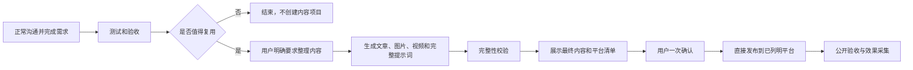
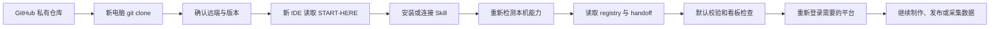

# 本机使用与跨机迁移详细教程

这份教程面向第一次使用本工作台的人。你不需要先理解所有 JSON、校验器或发布回执；先按“最快开始”操作，遇到问题再查后面的详细章节。

## 1. 先理解它负责什么

这不是需求管理工具，也不会在你做需求时自动写文章。正确顺序是：



看板只记录从步骤 E 开始形成的内容项目、平台发布和效果数据，不统计你完成了多少需求。

## 2. 两种使用方式

| 场景 | 你要做什么 | 推荐入口 |
|---|---|---|
| 当前电脑继续使用 | 在 IDE 中打开现有工作区，让 Agent 读取本工作台 | `START-HERE.md` |
| 换电脑或换 IDE | 克隆私有 GitHub 仓库，再让新 Agent 恢复 | 本仓库地址 |
| 只想查看发布情况 | 双击本地看板 | `dashboard/index.html` |
| 想让 Agent 一次读懂全部规则 | 粘贴完整执行提示词 | `EXECUTE-PROMPT.md` |

### 2.1 Codex 已安装 Skill 时

本工作台自带真正的 Codex Skill：`content-publishing-sop`。安装后可以直接在 Codex 中说：

```text
使用 $content-publishing-sop，把这次已完成并验收的需求整理成文章，发布到知乎和小红书。
```

Skill 会自动寻找当前工作区中的 `content-publishing-sop`，然后读取工作台真源。Skill 本身只是启动与编排入口，不复制完整 SOP，因此规则仍只维护一份。

Skill 只适用于 Codex。Claude Code、Cursor、Windsurf、VS Code Agent 和 Grok 继续使用 `adapters/` 中的入口。

---

# 第一部分：本机使用

## 3. 本机最快开始

假设你正在当前电脑的 Codex、Claude Code、Cursor、Windsurf 或 VS Code Agent 中工作。

### 第一步：先完成原需求

继续用你平时的方式讨论、修改和验收需求。此时不要创建内容项目，也不用操作看板。

适合进入内容流程的例子：

- 一个问题已经修好，并完成了真实测试；
- 中间有多轮讨论、失败方案和最终方案；
- 这套方法可以被其他项目或其他人复用；
- 你愿意把过程公开或内部分享。

不适合进入内容流程的例子：

- 功能还没有完成；
- 只有想法，没有实施结果；
- 关键结果没有验收证据；
- Agent 自己觉得值得写，但你没有要求整理内容。

### 第二步：明确发起内容沉淀

需求验收后，对 Agent 说：

```text
这个需求已经完成并验收。我认为整个过程有复用价值。
请读取 content-publishing-sop/START-HERE.md，
把这次完整过程整理成文章、图片和视频，并按 SOP 执行。
先恢复全过程和验收证据，不要遗漏最终完整的一键执行提示词。
```

如果工作台目录不是 `content-publishing-sop`，把路径替换成实际路径即可。

### 第三步：等待 Agent 创建内容项目

Agent 应当先证明两件事：

1. 来源需求已经完成并验收；
2. 你要求整理内容的时间晚于或等于验收时间。

然后才会复制 `templates/project/`，创建类似下面的目录：

```text
content-publishing-sop/
└── projects/
    └── my-content-project/
        ├── project-manifest.json
        ├── decision-log.json
        ├── content-requirements.json
        ├── platform-status.json
        ├── publication-receipts.json
        ├── metrics.json
        ├── HANDOFF.md
        ├── handoff-state.json
        └── content/
            ├── master.md
            └── canonical-prompt.md
```

正常情况下你不需要手工填写这些 JSON。让 Agent 根据聊天、修改记录、测试结果和你的确认写入，再运行校验器。

### 第四步：检查最终内容

发布前，Agent 必须一次性给你看清楚：

- 完整文章；
- 图片及顺序；
- 视频及配音、字幕；
- 完整的一键执行提示词；
- 每个平台将发布的版本；
- 明确的平台清单；
- 校验结果和仍然存在的风险。

如果内容需要修改，直接指出问题。修改后必须重新校验、重新冻结版本，再给你检查。

### 第五步：确认并发布

当内容和平台清单都正确时，回复：

```text
确认，内容无误，按上面列出的平台发布。
```

这一句同时完成“内容审核通过”和“授权发布到已列明平台”。Agent 不应再问第二次“是否发布”。

以下动作不包含在这次确认里，仍会单独询问：

- 删除、下架或覆盖旧内容；
- 新增没有在清单里展示的平台；
- 站外同步、版权或商业协议；
- 登录、验证码、MFA 或付款；
- 公开发送隐私或未公开资料。

### 第六步：查看看板

双击下面的文件：

```text
content-publishing-sop/dashboard/index.html
```

看板显示：

- 已登记的内容项目；
- 文章、图片和视频数量；
- 各平台发布状态；
- 公开读者验收状态；
- 当前冻结版本和发布回执；
- 浏览、点赞、收藏、评论、分享等效果数据；
- `unknown` 和有证据的真实 `0`。

看板中的“来源需求”只是说明这篇内容从哪里来，不会计入需求数量。

## 4. 本机完整操作流程

### 4.1 打开正确目录

在 IDE 中打开包含本工作台的工作区。若使用终端，进入工作台根目录：

```bash
cd /你的路径/content-publishing-sop
```

判断是否进入正确目录：

```bash
ls START-HERE.md SOP.md validator tools dashboard
```

Windows PowerShell 可以使用：

```powershell
Set-Location "D:\你的路径\content-publishing-sop"
Get-ChildItem START-HERE.md,SOP.md,validator,tools,dashboard
```

### 4.2 检查最小环境

核心流程只要求：

- 能读写 Markdown 和 JSON 的 IDE 或 Agent；
- Python 3.9 或更高版本；
- 一个能打开本地 HTML 的现代浏览器。

检查 Python：

```bash
python3 --version
python3 validator/validate.py --help
```

Windows 如果没有 `python3` 命令，可以把本教程中的 `python3` 替换为：

```powershell
py -3
```

例如：

```powershell
py -3 validator\validate.py --help
```

### 4.3 安装 Codex Skill（推荐）

先检查本机状态：

```bash
python3 tools/install_local_skill.py --check
```

如果显示 `not_installed`，安装：

```bash
python3 tools/install_local_skill.py
```

默认目标是：

```text
~/.codex/skills/content-publishing-sop
```

安装写入 Codex 用户目录，Codex 可能要求你确认文件权限。安装完成后，在下一条消息中使用 `$content-publishing-sop`；如果技能列表还没刷新，重新打开 Codex。

如果显示 `conflict`，说明目标目录已有不同版本。安装脚本不会覆盖它。先比较现有版本和仓库版本，再明确决定是否替换，不能静默覆盖。

如果显示 `installed`，代表已安装版本与仓库版本完全一致，无需重复操作。

### 4.4 检测本机可调用能力

运行：

```bash
python3 tools/capability_check.py --write reports/capability-report.json
```

重点看这些状态：

| 状态 | 含义 |
|---|---|
| `unavailable` | 当前没有入口 |
| `detected` | 找到了，但还没完成真实测试 |
| `tested` | 已运行代表性测试 |
| `blocked` | 工具存在，但被权限、登录或网络阻断 |
| `manual` | 只能由人操作 |

Browser Use、ChatCut 和 FFmpeg 都不是工作台运行的硬依赖：

- 没有 Browser Use：可以改用 IDE 浏览器、Playwright 或人工检查公开页面；
- 没有 ChatCut：可以使用其他 IDE 可调用的视频工具或人工时间线；
- 没有 FFmpeg：视频技术验收改为人工，但不能假装自动检查已经完成。

### 4.5 登记一个新内容项目

推荐让 Agent 自动完成。可以直接发送：

```text
来源需求已经完成并验收，请为它创建一个新的内容项目。

要求：
1. 读取 START-HERE.md、AGENT-PROTOCOL.md、SOURCE_OF_TRUTH.md 和 SOP.md；
2. 从 templates/project 复制模板到 projects/<简短项目ID>；
3. 在 decision-log.json 中完整恢复原始需求、问题、尝试、反馈、决定、理由、实施、验收和未解决项；
4. 在 project-manifest.json.source_work 中引用真实的验收事件和本次内容请求事件；
5. 写明为什么值得复用；
6. 把项目加入 projects/registry.json；
7. 先运行默认校验，报告缺口，不要提前发布。
```

项目 ID 使用小写英文、数字和短横线，例如：

```text
browser-agent-isolation
meeting-summary-workflow
content-publishing-repair
```

### 4.6 检查内容项目是否合格

假设项目目录是 `projects/my-content-project`：

```bash
python3 validator/validate.py \
  --project projects/my-content-project \
  --write-report validation-report.json
```

成功标志：

```text
[PASSED] my-content-project
errors=0
```

如果有 `WARNING`：

- 默认模式允许保留真实警告；
- 冻结和正式交付前应判断警告是否可以修复；
- 不能把警告删除或伪造成成功。

如果有 `ERROR`：

- 发布门禁阻断；
- 根据错误中的文件路径修复；
- 修复后重新运行，不沿用旧报告。

### 4.7 冻结最终内容版本

内容全部完成后计算摘要：

```bash
python3 tools/release_digest.py --project projects/my-content-project
```

命令会输出 64 位 SHA-256。Agent 需要把它写入 `project-manifest.json.release.release_digest`，同时写入版本号、冻结时间和最新决策序号，再运行：

```bash
python3 validator/validate.py \
  --project projects/my-content-project \
  --strict
```

冻结后如果文章、图片、视频、提示词或来源身份发生改变，旧摘要和旧发布授权都会失效，必须重新计算。

### 4.8 验证发布授权

在你确认最终内容和平台清单后，Agent 会创建一次性 grant。真正访问平台前应按整批平台运行：

```bash
python3 validator/validate.py \
  --project projects/my-content-project \
  --action public_publish \
  --platform 知乎 \
  --platform 小红书
```

如果是更新已经存在的文章，动作必须改成：

```text
update_publication
```

不能用 `public_publish` 冒充更新，也不能用旧的 `public_publish=true` 布尔值冒充本次授权。

### 4.9 发布后验收

平台操作完成后运行：

```bash
python3 validator/validate.py \
  --project projects/my-content-project \
  --postflight
```

必须从普通读者视角验证：

- 公开链接能打开；
- 正文、图片和视频完整；
- 完整提示词确实能获取；
- 页面不是草稿、审核中、登录后预览或作者后台；
- 发布回执与线上版本一致。

### 4.10 重建看板

内容、平台状态、指标或校验报告发生变化后运行：

```bash
python3 tools/build_dashboard.py
python3 tools/build_dashboard.py --check
```

成功标志：

```text
dashboard=current
```

如果显示 stale，重新构建并检查项目真源，不要手工改 `dashboard/data.js`。

### 4.11 采集发布效果

指标检查点到期时，将带证据的快照追加到 `metrics.json`，然后运行：

```bash
python3 validator/validate.py \
  --project projects/my-content-project \
  --require-metrics
```

规则：

- 没读到的数据写 `null`，看板显示 `unknown`；
- 数字 `0` 只能表示来源明确证明实际为零；
- 每个非空数字都需要时间、来源和证据；
- 新快照只能追加，不能覆盖历史。

## 5. 本机暂停和恢复

离开前，让 Agent 更新：

- `HANDOFF.md`：给人看的交接；
- `handoff-state.json`：给另一个 Agent 读取的交接；
- `validation-report.json`：最近一次校验结果；
- `dashboard/data.js`：最近一次看板缓存。

恢复时发送：

```text
读取 content-publishing-sop/START-HERE.md、projects/registry.json，
以及目标项目的 HANDOFF.md 和 handoff-state.json。
不要依赖旧聊天，先告诉我当前阶段、已完成项、阻塞项、有效授权和下一步最小动作。
```

---

# 第二部分：跨机使用

## 6. 跨机迁移原理



可以迁移的内容：

- SOP 和跨 IDE 规则；
- 内容项目和来源证据；
- 文章、图片、视频和完整提示词；
- 冻结摘要、发布回执和平台状态；
- 指标历史、看板数据和交接状态。

通常不能直接迁移的内容：

- 浏览器登录状态；
- 验证码和 MFA；
- 操作系统级权限；
- 本机安装的 IDE 插件和 Skill；
- Browser Use 隔离 Chrome 配置；
- 付费 API 密钥、Cloud 会话和系统钥匙串。

## 7. 在新电脑获取仓库

推荐使用 Git 克隆私有仓库：

```bash
git clone https://github.com/<GitHub账号>/content-publishing-sop.git
cd content-publishing-sop
```

仓库默认只保存可复用的 SOP、Skill、模板、校验器和看板源码，不包含个人内容项目。需要跨机继续某个内容项目时，应在明确审查隐私、素材版权和平台链接后，把该项目放入受控的私有存储；不要未经检查直接提交到仓库。

如果不能使用 Git，也可以从 GitHub 下载源码 ZIP。它只是某个提交的快照；应从可信仓库下载，并记录对应提交，而不是假定本地文件天然是最新版本。

## 8. 在新电脑确认版本

在仓库目录运行：

```bash
git remote -v
git status -sb
git log -1 --oneline
```

确认三件事：远端属于预期账号和仓库、当前分支没有意外修改、最新提交是你打算使用的版本。后续更新使用：

```bash
git pull --ff-only
```

如果使用 GitHub 下载的源码 ZIP，解压后应看到一个工作台目录：

```text
content-publishing-sop/
├── START-HERE.md
├── skills/
├── templates/
├── validator/
└── dashboard/
```

然后用 IDE 打开这个目录。源码 ZIP 没有 Git 历史；需要持续同步时优先使用 `git clone`。

## 10. 在新 IDE 中启动

### Codex：先安装仓库内的 Skill

进入仓库目录，运行：

```bash
python3 tools/install_local_skill.py --check
python3 tools/install_local_skill.py
```

安装成功后，在 Codex 下一条消息中使用：

```text
使用 $content-publishing-sop，恢复这个迁移项目并告诉我下一步。
```

Skill 会寻找当前工作区中的工作台，不使用原机器绝对路径。若工作区里有多个工作台，它会列出候选项并让你选择，不会擅自选错。

### 任意 IDE：使用通用启动提示词

最通用的启动提示词：

```text
请先在当前工作区查找并完整读取：
content-publishing-sop/START-HERE.md

然后读取 AGENT-PROTOCOL.md、SOURCE_OF_TRUTH.md、SOP.md、
projects/registry.json，以及目标项目 manifest 指向的全部真源文件。

这是从另一台机器迁移来的工作区。不要依赖旧聊天，也不要假设本机已经安装原机器上的插件。
请先：
1. 验证 source_work，确认来源需求已验收、内容请求发生在验收之后；
2. 运行能力检测；
3. 从 HANDOFF.md 和 handoff-state.json 恢复阶段、证据、阻塞项和下一步；
4. 运行默认内容校验、看板新鲜度检查和可移植性检查；
5. 列出本机缺少的工具、需要重新登录的平台，以及最小下一步；
6. 在我确认最终内容和明确平台清单前，不执行公开发布。

最终内容和平台清单经我一次确认后，可以直接发布到这些平台，不要再二次询问。
删除、覆盖、站外同步、登录、验证码、MFA、授权和付款仍需单独确认。
```

### 各 IDE 的推荐入口

| IDE | 新机器上的操作 |
|---|---|
| Codex | 优先安装仓库内 Skill；也可读取 `adapters/codex/README.md` 并合并项目级 `AGENTS.md` |
| Claude Code | 读取 `adapters/claude-code/README.md`；项目已有 `CLAUDE.md` 时只合并，不覆盖 |
| Cursor | 读取 `adapters/cursor/README.md`；把薄规则合并到 `.cursor/rules/` |
| Windsurf | 读取 `adapters/windsurf/README.md`；使用项目级 `AGENTS.md` 或 `.windsurf/rules/` |
| VS Code Agent | 读取 `adapters/vscode-agent/README.md`；合并 `.github/copilot-instructions.md` |
| Grok TUI | 默认粘贴通用提示词；写入用户级 bridge 前重新确认当前机器绝对路径 |
| 其他 IDE | 使用 `adapters/generic-agent/PROMPT.md` |

适配器只是让 IDE 找到工作台，不保存长期业务逻辑。不要把整套 SOP 复制进多个 IDE 规则文件，否则以后容易出现多个版本。

## 11. 新电脑第一次自检

进入 `content-publishing-sop` 后运行：

```bash
python3 tools/capability_check.py
python3 tools/build_dashboard.py
python3 tools/build_dashboard.py --check
python3 tools/portability_check.py
cd validator
python3 -m unittest -v test_validator.py
```

成功结果应包括：

- Python 版本满足 3.9+；
- 校验器测试全部通过；
- 看板显示 `dashboard=current`；
- 可移植性检查为 `passed`；
- 缺少的增强工具被标为 `unavailable`、`detected` 或 `manual`，而不是伪装成 `tested`。

## 12. 恢复目标项目

让 Agent 按以下顺序读取：

1. `projects/registry.json`；
2. 目标项目的 `project-manifest.json`；
3. `HANDOFF.md`；
4. `handoff-state.json`；
5. `decision-log.json`；
6. `content-requirements.json`；
7. `platform-status.json`；
8. `publication-receipts.json`；
9. `metrics.json`；
10. 最近的 `validation-report.json`。

Agent 应先报告：

- 当前内容阶段；
- 来源需求和验收证据；
- 最终内容版本和摘要；
- 已发布、审核中、失败和未知的平台；
- 是否存在未完成的 pending intent；
- 是否存在仍有效且与当前摘要匹配的 grant；
- 新机器缺少什么能力；
- 下一步最小动作。

如果存在状态为 `unknown` 的 pending intent，必须先到外部平台核对是否已经执行，不能直接重试，以免重复发布。

## 13. 重新登录平台

仓库不会保存账号密码、Cookie、验证码或 MFA。需要发布或读取创作者后台数据时：

1. Agent 打开指定的专用浏览器或隔离环境；
2. 你手工登录；
3. 你完成验证码、MFA 和协议确认；
4. Agent 再继续已授权的页面操作。

不要把浏览器用户数据目录、系统钥匙串、API 密钥或账号 Cookie 提交进仓库。

## 14. 新电脑继续发布

迁移后不能只根据一句“原电脑已经确认过”直接发布。先运行动作门禁：

```bash
python3 validator/validate.py \
  --project projects/my-content-project \
  --action update_publication \
  --platform 知乎
```

只有满足以下条件才继续：

- release 仍然 frozen；
- 内容摘要没有改变；
- grant 的动作、平台和摘要完全匹配；
- grant 没过期、没消费、没撤销；
- 没有未对账的 pending intent；
- 没有相同 release、平台和动作的成功回执。

如果迁移后修改了任何发布内容，应重新冻结，并重新向你展示最终内容与平台清单。你一次确认后直接发布，不再单独问“是否发布”。

## 15. 跨机迁移完成标准

迁移完成不是“文件能打开”，而是下面各项都成立：

- [ ] 仓库来源、分支和最新提交符合预期；
- [ ] 工作区没有意外的未提交修改；
- [ ] Python 3.9+ 可用；
- [ ] 新 IDE 能读取 `START-HERE.md`；
- [ ] 能从项目文件恢复完整上下文，不依赖旧聊天；
- [ ] 默认内容校验结果符合预期；
- [ ] 看板重建并显示 `current`；
- [ ] 可移植性检查通过；
- [ ] 新机器能力重新检测，没有沿用旧机器报告；
- [ ] 需要的平台已重新登录；
- [ ] 未知状态和真实零值没有混淆；
- [ ] 发布、删除、同步和付款边界仍然正确。

---

# 第三部分：常见问题

## 16. 常见问题与处理方法

| 问题 | 原因 | 处理 |
|---|---|---|
| 看板全部是 0 | 没有真实指标，或误把 unknown 显示成 0 | 重新构建看板；没有证据的数据保持 `null` |
| 看板没有新项目 | 项目没有加入 `projects/registry.json` | 登记项目并重建看板 |
| 看板显示 stale | 真源变化后没有重建缓存 | 运行 `build_dashboard.py` 和 `--check` |
| 默认校验失败 | JSON 缺字段、证据路径失效或内容不完整 | 按错误路径修复后重跑 |
| strict 模式失败 | 仍有真实警告 | 判断是否可修复；不能删除事实来过关 |
| 新电脑找不到图片或视频 | 私有内容项目没有迁移，或项目内相对目录改变 | 从受控私有存储恢复项目，重新运行可移植性检查 |
| Agent 又问一次“是否发布” | 没有识别最终内容确认同时授权平台发布 | 让它重新读取 `AGENT-PROTOCOL.md` 第 5 节 |
| Agent 提前开始写文章 | 没检查来源需求是否验收 | 检查 `source_work`，未验收时退出内容流程 |
| Browser Use 在新机不可用 | Skill、CLI、引擎或隔离启动器没有迁移 | 重新运行能力检测，按本机环境安装或改用人工路径 |
| 发布动作重复 | 中断后没有核对 pending intent，或已有成功回执 | 先外部对账，禁止直接重试 |
| 平台后台显示成功但公开页看不到 | 后台状态不等于读者结果 | 运行 postflight，保存普通读者证据 |
| 完整提示词太长 | 平台正文或简介放不下 | 长文逐字放全文；图文平台使用连续高清提示词图并验证页码 |

## 17. 哪些事情需要你亲自操作

通常需要你处理：

- 账号登录；
- 验证码和 MFA；
- 付款；
- 新协议、版权或商业授权；
- 删除或覆盖公开内容的最终确认；
- 平台强制要求的人工安全验证。

Agent 可以准备材料、打开页面、填写非敏感内容和检查结果，但不能把“需要人操作”写成已经完成。

## 18. 推荐的日常用法

最省心的方式是：

1. 平时正常做需求；
2. 需求验收后，只有你认为值得复用时才发起内容沉淀；
3. 所有新内容项目放入 `projects/`；
4. 让 Agent 维护 JSON、校验报告和看板；
5. 你只在最终内容、平台清单和高风险动作上做决定；
6. 定期提交可复用工作台更新；个人内容项目只有在完成隐私和授权审查后才进入受控私有存储；
7. 换机时从 GitHub 真源恢复工作台，不依赖聊天记忆。

## 19. 相关入口

- `START-HERE.md`：最短入口；
- `EXECUTE-PROMPT.md`：可直接交给任意 IDE Agent 的完整提示词；
- `SOP.md`：完整生命周期；
- `AGENT-PROTOCOL.md`：所有 Agent 必须遵守的核心协议；
- `INSTALL.md`：工具安装和能力边界；
- `skills/content-publishing-sop/`：可安装的 Codex Skill 源码；
- `tools/install_local_skill.py`：安全安装或检查本机 Skill；
- `dashboard/index.html`：本地内容发布看板；
- `adapters/`：各 IDE 的薄适配入口。
